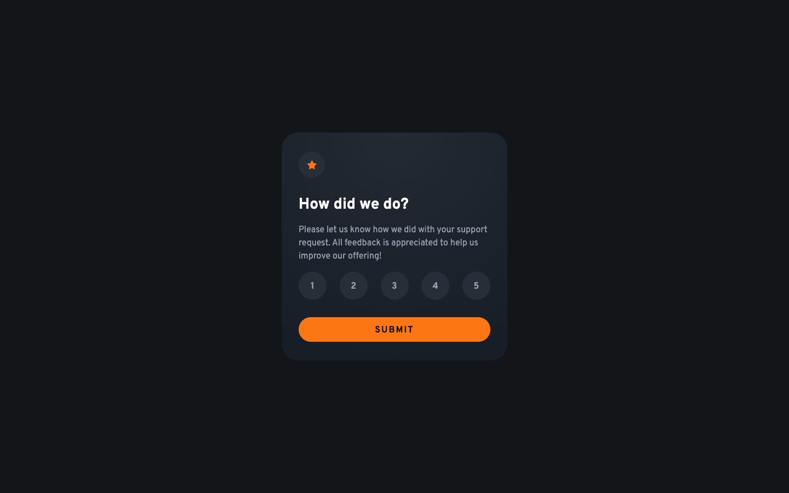

# Frontend Mentor - Interactive rating component solution

This is a solution to the [Interactive rating component challenge on Frontend Mentor](https://www.frontendmentor.io/challenges/interactive-rating-component-koxpeBUmI). My app lets users choose a rating from 1 to 5, submit it, and see a thank-you message with their selection.

## Table of contents

- [Overview](#overview)
  - [The challenge](#the-challenge)
  - [Screenshot](#screenshot)
  - [Links](#links)
- [My process](#my-process)
  - [Built with](#built-with)
  - [What I learned](#what-i-learned)
  - [Continued development](#continued-development)
- [Run it locally](#run-it-locally)
- [Author](#author)

## Overview

### The challenge

Users should be able to:

- View the card on small and large screens.
- See hover and selected states for the rating options.
- Choose and submit a rating from 1 to 5.
- See a thank-you message with the submitted rating.
- Use the keyboard to select a rating and submit it.
- See an error and move focus to the first option when submitting without a rating.
- Try another rating after submitting.

### Screenshot



### Links

- Solution URL: [My Frontend Mentor solution](https://www.frontendmentor.io/solutions/interactive-rating-with-nextjs-typescript-and-tailwind-DGZnSRA9IH)
- Live Site URL: [Interactive Rating](https://interactive-rating.royeradames.com)

## My process

### Built with

- Next.js 16.3.6
- React 19.2.8
- TypeScript 5.9.3
- Tailwind CSS 4.2.1 and custom CSS
- CSS Grid and Flexbox
- Native HTML radio buttons
- Overpass through `next/font/google`
- Playwright for browser checks
- ESLint

### What I learned

I learned that native radio buttons give me keyboard selection without custom arrow-key handlers. I use one `name` for all five inputs, so the browser handles moving between the options.

I also learned to design the empty-submit state. If no rating is selected, I show an error and focus the first radio button. After a valid submission, I focus the thank-you heading. Trying another rating clears the selection and returns focus to the first option.

PR 2 found the card running off a 320 px screen and the Figma "Selected (white)" and hover orange states missing. I now limit the card to the available width and let the rating circles shrink. I use separate checked and hover rules for the two colors. The Playwright checks cover both card states from 320 to 1600 px and check the selected and hover colors.

### Continued development

- I have only configured Chrome in Playwright. Firefox and WebKit coverage is still missing.

## Run it locally

I use Node 24. Install dependencies and start the development server:

```bash
npm ci
npm run dev
```

For linting, type checking, a production build, and browser checks:

```bash
npm run lint && npm run typecheck && npm run build
npm test
```

The Playwright suite uses installed Chrome and starts the production server on port 4682 by default. Set `PORT` to use another port. Build before running it. The checks cover keyboard use, validation, reset, design frames, a 320 to 1600 px width sweep in both states, and behavior without JavaScript.

This is a practice demo. Ratings stay in memory on the page. I do not send or store them. Without JavaScript, the page shows a notice and submits nothing.

I follow the Figma desktop, tablet, and mobile frames. I keep text at least 16 px, raising the design's 14 and 15 px text. I also add visible focus and a reset action.

The official designs are in `reference/design/`. The visual references and images came from [Frontend Mentor's interactive rating repository](https://github.com/frontendmentorio/interactive-rating-component) on October 7, 2026. I wrote the application code independently.

I use "Interactive Rating" for `og:site_name` and the WebSite JSON-LD name. Next.js generates a 1200 × 630 Open Graph image at build time.

## Author

- Website - [Royer Adames](https://royeradames.com)
- Frontend Mentor - [@royeradames](https://www.frontendmentor.io/profile/royeradames)
